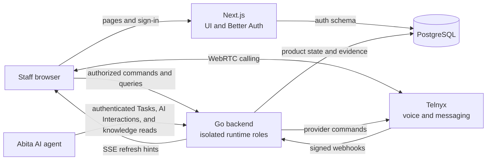

# Acuity Portal

Acuity Portal is the shared workspace where medical-practice teams turn patient
communication into accountable work. Staff can see what needs attention, who
owns it, what has already happened, and whether the need reached a real outcome.

The Abita AI agent owns the automated patient conversation. This repository
owns the staff workspace, human calling and messaging, Tasks, and the evidence
that connects them.

[Product](#what-the-workspace-does) · [Architecture](#architecture) ·
[Local development](#local-development) · [Verification](#verification) ·
[Operations](#releases-and-operations)

## What the workspace does

- **Tasks:** capture a patient need, its next action, assignment, priority, and
  completion. Keep the Activity timeline when work is completed or reopened.
- **Calling:** receive AI-to-human transfers, make outbound calls, transfer
  between Staff, and record post-call outcomes. Keep voicemail and authorized
  recording playback beside the work.
- **Messaging:** send and receive Location-scoped SMS/MMS, track delivery and
  attachments, and create follow-up Tasks when staff identifies work to do.
- **Manage my agent:** staff can search recent calls, read conversation transcripts,
  and flag a call with a durable note. Acuity Platform Operators review these in
  Manage my agent using the Flagged calls filter within the selected Practice.
  Flags preserve the original report; they do not create patient Tasks or send notifications.
  Manage my agent also lets staff edit the knowledge Abita uses at each authorized
  Location, see its version history, and restore an earlier version, and shows,
  read-only, the insurance list.
- **AI evidence:** preserve AI Interactions, transcripts, and receipt-backed
  appointment outcomes without treating an automated claim as proof of success.

A resolved Interaction should not create unnecessary work. An unresolved need
should remain visible until it reaches an accountable outcome. Incoming texts
create shared review Tasks, except opt-out/control messages. Appointment, text,
missed-call, and voicemail reviews appear for everyone with access to their
Location, independent of category responsibility. Checking an appointment clears
its review for everyone. A completed callback attempt clears older call recovery
reviews even if the patient does not answer; history records the attempt without
claiming patient contact. Any remaining patient obligation needs separate follow-up.

A **Practice** is the customer tenant and security boundary; a **Location** is
an office within it. Google sign-in establishes human identity, and the backend
enforces Memberships and Location Scope. Practice Admins and Acuity-wide
Platform Operators are distinct roles. Contact Context and phone-number history
help staff act; neither is verified patient identity or a medical record.

## Architecture

The system has three foundations: a **Next.js frontend**, a **Go modular
monolith**, and **PostgreSQL as the durable source of truth**. Telnyx supplies
voice and messaging. Better Auth supplies Google authentication and sessions;
the Go `Access` module owns product authorization.



### One backend, five runtime roles

The same Go binary and backend image run in five modes, selected by
`ACUITY_RUNTIME_ROLE`. These are workload boundaries, not separate
microservices: they share domain code and committed PostgreSQL state.

| Role | Responsibility | Production resource |
| --- | --- | --- |
| `portal-api` | Authenticated staff and AI commands and queries | Cloud Run service |
| `provider-ingress` | Verify provider webhooks and commit durable receipts | Cloud Run service |
| `realtime` | Send authorized server-sent event (SSE) version hints | Cloud Run service |
| `worker` | Project receipts, execute durable commands, retry, and reconcile | Cloud Run worker pool |
| `migrate` | Apply reviewed schema migrations, grants, and provisioning | Cloud Run job |

The frontend runs as a separate Cloud Run service. Production uses Cloud SQL
PostgreSQL 16 and private storage for messaging attachments. Telnyx owns call
recording and voicemail audio; the backend checks access and streams it without
exposing provider credentials or raw download URLs.

### Code ownership

Business rules live in their owning module under `backend/internal/`.

| Module | Package | Owns |
| --- | --- | --- |
| Access | [`access/`](backend/internal/access) | Identity, Access Grants, Memberships, scopes, and authorization |
| Work | [`work/`](backend/internal/work) | Task lifecycle, assignment, priority, and Activity |
| HumanCalling | [`humancalling/`](backend/internal/humancalling) | Calls, CallLegs, softphone readiness, transfers, voicemail, and recordings |
| Messaging | [`messaging/`](backend/internal/messaging) | Conversations, send intent, delivery evidence, and attachments |
| AIInteraction | [`interaction/`](backend/internal/interaction) | AI call lifecycle, transcripts, appointment evidence, and analytics |
| Knowledge | [`knowledge/`](backend/internal/knowledge) | Office knowledge revisions, controlled imports, and agent reads |
| Insurance | [`insurance/`](backend/internal/insurance) | Each Practice's insurance list as immutable revisions validated by the middleware, and the staff view of the middleware's plan rules for a Location |

The [`workspace/`](backend/internal/workspace) query layer combines authorized
cross-domain views; it does not own domain writes. HTTP, authentication,
provider, storage, and worker adapters connect to the owning modules.

The backend test suite enforces these boundaries in
[`architecture/`](backend/internal/architecture): only `httpapi` imports the
generated API, domain modules import only reviewed domain edges, and SQL may
use only its own module's tables (by migration prefix) while `workspace` only
reads. Existing cross-module SQL is a shrinking baseline in that package. It
also rejects comments in hand-written Go; only tool directives such as
`//go:generate` and `//go:embed` are allowed. Migration SQL is outside that
scan: the softphone takeover trigger in migration `0106` reads Access's
operational scopes, as `softphone.go` already does.

Knowledge uses Access for Practice and office authorization and PostgreSQL for
entries and immutable revisions; the Agent has read-only access.
Each office's active database revision is its only knowledge source; staff
publish complete office revisions through the Portal backend, as described in the
[Knowledge workflow](knowledge/README.md). The Agent reads the whole active
revision for its office, in saved order. Staff read a Location's current revision
through its single Abita Office Route.

Insurance keeps each Practice's whole insurance list (carriers, region plans,
and office tables, in the middleware's `InsuranceCatalog` shape) as one chain
of immutable revisions. `POST /v1/insurance/revisions` publishes a complete
list against the revision it started from. Regions share plan rows across
offices, so a publish needs mutation access to the Location of every office
whose carriers, region plans, or tables it changes, not only the requested
Location; an office with no Location needs a Platform Operator. The middleware
office mapping is `middlewareOffices` in
[`middleware.go`](backend/internal/insurance/middleware.go). The middleware
owns plan semantics: every publish is checked by its
`POST /api/insurance/catalog/validate` first, its errors return verbatim, and
nothing changes when it rejects or cannot be reached. The middleware reads
the active revision through `POST /v1/agent/insurance/read` with its own
service credential, which holds only `READ_INSURANCE`.

The browser/backend contract is [`api/openapi.yaml`](api/openapi.yaml).
Go bindings and the TypeScript client are generated from it, not edited by hand.

### How state becomes trustworthy

1. **Authorize the action.** Resolve the real actor and their Practice and
   Location access. Client-supplied IDs are requested context, not permission.
2. **Commit intent before effects.** Save product state and durable provider
   commands before contacting an external provider. Provider I/O stays outside
   database transactions.
3. **Commit evidence before acknowledging it.** A valid webhook receives a
   success response only after its unique receipt is durable. Workers project
   receipts and recover interrupted work with bounded retries and reconciliation.
4. **Refresh from committed state.** SSE carries version hints, not authoritative
   product state. The browser refetches authorized views. Calling changes also
   send a Practice-scoped `calling` hint; the softphone refetches Calling state
   on each hint and keeps fast polling only while a call rings or is active,
   with a slow idle fallback poll. It polls faster while the stream is down,
   silent, or does not cover every Practice in the user's Calling state.
   Neither browser intent nor a successful provider request
   proves that a call connected or a message was delivered. Database triggers
   own `human_calling_calls.version` and the `calling` hint, so writers lock the
   Call before writing its CallLegs, commands, transfers, voicemails, or
   recordings, and never set the version or send the hint themselves.

## Local development

Run the commands below from the repository root. The frontend package lives in
`web/`; there is no root JavaScript package.

### Prerequisites

- Go 1.27 and Node.js 26. Exact CI versions are pinned in
  [the verification workflow](.github/workflows/verify.yml).
- pnpm 12.15.0, matching [`web/package.json`](web/package.json).
- A running local PostgreSQL 16 server, the `psql` and `createdb` tools, and
  `curl`. Use a disposable local database cluster whose user is a superuser:
  integration tests reset schemas, create the runtime roles, and connect as
  them.

Install dependencies:

```sh
go mod download
pnpm --dir web install --frozen-lockfile
```

### Prepare disposable databases

**Tests reset schemas. Never point these commands at production or a database
containing data you need.** Backend tests require a name ending in `_test`;
browser tests require `_e2e`.

These examples assume local PostgreSQL accepts your current OS user on
`127.0.0.1` and has the pgvector extension installed; without it, migrations
stop at `0066_office_knowledge`. Homebrew's `pgvector` installs only for
`postgresql@17` and newer, so run tests on `postgresql@17` or CI's
`pgvector/pgvector:0.8.5-pg16-bookworm` image.
Adjust the connection settings for your local installation. Create
the databases once, then set the URLs in the shell where you run the tests.

```sh
createdb --host=127.0.0.1 acuity_test
createdb --host=127.0.0.1 acuity_e2e

export TEST_DATABASE_URL='postgres://127.0.0.1/acuity_test?sslmode=disable'
export E2E_DATABASE_URL='postgres://127.0.0.1/acuity_e2e?sslmode=disable'
```

### Run the full-stack browser journey

The repository's self-contained local startup path is the
[end-to-end harness](scripts/run-e2e.sh):

```sh
pnpm --dir web exec playwright install chromium
./scripts/run-e2e.sh
```

It resets the E2E schemas, applies migrations and
[synthetic provisioning](config/development-provisioning.json), starts the
frontend and backend roles, runs Chromium tests, and stops the processes when
finished. Ports `13000`, `18080`, `18081`, `18082`, and `19000` must be free.
On Linux, browser system dependencies may also be needed; CI installs Chromium
with `--with-deps`.

The harness uses test sessions and a local Telnyx fixture. It does not require
live Google or Telnyx credentials, and it does not prove real sign-in, carrier
delivery, or live-call media behavior. It is a test runner, not a persistent
development server.

### Interactive development

For a persistent local environment, run `migrate` once, then start `portal-api`,
`provider-ingress`, `realtime`, and `worker` as separate processes. There is no
single persistent-stack launcher; use the role configuration in
[`scripts/run-e2e.sh`](scripts/run-e2e.sh) as the synthetic reference and
[`backend/internal/app/config.go`](backend/internal/app/config.go) for the
required environment variables. The Go process reads exported environment
variables, not `.env` files.

The `worker` uses `OPENROUTER_API_KEY` for the two post-call choice judges
(primary intent and outcome), through OpenRouter Decisions with ZDR required.
Export it only in the worker process's environment; do not commit its value.
New closeouts are queued after migration `0100`; historical calls are not
automatically sent for inference. A transfer stays pending until its scoped
provider call and legs finish. Existing quality judges remain independent.

Missing keys, provider failures, and malformed responses persist as `failed`
labeling, with at most three automatic attempts. Empty conversations are
`skipped`; voicemail without reviewed content retains its intent but withholds
the outcome. `skipped` and `failed` describe labeling status, not call outcomes.
A greeting followed by caller disconnect is `other` / `abandoned`; abandonment
describes the call ending and does not by itself prove an agent failure.
Fixed-choice model accuracy on ambiguous or nonservice calls still needs human
review against a labeled sample.
Inspect `ai_interaction_classifications.error_code` using authorized database
access. After fixing the cause, retry a deliberately selected call with:

```sql
UPDATE ai_interaction_classifications
SET status='pending', attempts=0, error_code=NULL, claim_token=NULL,
    lease_expires_at=NULL, next_attempt_at=now(), updated_at=now()
WHERE interaction_id = '<reviewed-interaction-uuid>';
```

A deliberate historical sample can be queued by inserting its reviewed
interaction IDs into `ai_interaction_classifications(interaction_id)` with
`ON CONFLICT DO NOTHING`. No automatic all-history backfill runs.

`portal-api` reads insurance rules from the AdvancedMD middleware, and
validates insurance list publishes with it, when `MIDDLEWARE_BASE_URL` and
`MIDDLEWARE_API_SECRET` are both set; set neither to leave the insurance plans
endpoint and insurance publishes returning 503 Unavailable. The middleware's
own credential for `POST /v1/agent/insurance/read` is
`ABITA_EYE_GROUP_MIDDLEWARE_SERVICE_TOKEN`, with
`ABITA_EYE_GROUP_MIDDLEWARE_SERVICE_SUBJECT` and
`ABITA_EYE_GROUP_MIDDLEWARE_SERVICE_PRACTICE_ID`; set all three or none. Until
they are set, that read answers 401.

Seed a Practice's first insurance revision from an `InsuranceCatalog` JSON
file with the operator command. The file is the middleware's frozen export,
`internal/insurance/testdata/catalog.json` in amd_middleware, which this repo
keeps byte for byte as `backend/internal/insurance/testdata/export.json`. The
command parses the file strictly and has the middleware validate it. Without
`--apply` it stops there. `--apply` also needs `INSURANCE_IMPORT_DATABASE_URL`
and `INSURANCE_OPERATOR_EMAIL` (an existing bound Platform Operator, recorded
as the author) and publishes it with provenance `import`. Rerunning with the
same list changes nothing; once the Practice has a different active revision,
the command refuses and the list is changed in the Portal instead.

```sh
MIDDLEWARE_BASE_URL=... MIDDLEWARE_API_SECRET=... \
  go run ./backend/cmd/insurance-import --practice PRACTICE_UUID \
  --from-file backend/internal/insurance/testdata/export.json [--apply]
```

Configure the frontend using [web/README.md](web/README.md), then start it with:

```sh
pnpm --dir web dev
```

The dev server alone does not provide the authenticated workspace. Interactive
Google sign-in needs valid OAuth configuration and a preauthorized Access
Grant or Platform Operator binding. Test-session helpers are test-only. Never
commit secrets or copy production credentials into synthetic fixtures.

## Verification

Start with the check closest to your change. These are the main local commands
used by [CI](.github/workflows/ci.yml) through its
[reusable verification workflow](.github/workflows/verify.yml).

### Backend

With `TEST_DATABASE_URL` set to the disposable `_test` database:

```sh
go test -p 1 ./backend/... ./deploy -count=1
```

Keep database-backed packages serial: they share and reset schemas. Without
`TEST_DATABASE_URL`, integration tests may skip; a green exit is not proof that
database behavior passed. CI shards the complete package set across isolated
databases for pull requests, main, and exact-release verification. Packages
within each shard remain serial, and every shard must pass.

Integration tests open the database with `testdb.Open`, which creates the
runtime roles and applies `database-grants.sql`. Seed with SQL and provisioning
through `db.Owner`; construct modules with `db.As(testdb.Portal)` (or `Worker`,
`Provider`, `Realtime`), the role that runs that code in production, so a
missing grant fails the test with permission denied. Tests still on
`testdb.OpenAsOwner` are a shrinking baseline in `architecture/`.

### Frontend

```sh
pnpm --dir web lint
pnpm --dir web typecheck
pnpm --dir web test:unit
NEXT_PUBLIC_PORTAL_API_URL=http://127.0.0.1:18080 \
NEXT_PUBLIC_REALTIME_URL=http://127.0.0.1:18081 \
  pnpm --dir web build
```

Use the full-stack browser journey above for changes to user flows.

### Generated contracts

After changing `api/openapi.yaml`, regenerate both clients and review the diff:

```sh
go generate ./backend/internal/api
pnpm --dir web api:generate
```

CI also checks dependency vulnerabilities and Better Auth schema drift. For
auth schema changes, [`scripts/check-auth-schema.sh`](scripts/check-auth-schema.sh)
requires `AUTH_SCHEMA_CHECK_DATABASE_URL` pointing to a separate disposable
database ending in `_schema_check`; it also resets schemas.

## Releases and operations

Ordinary merges to `main` do not deploy. After successful main CI,
[Release Please](.github/workflows/release.yml) creates or updates the release
PR. Publishing a release triggers verification of the exact released commit
before the gated production deployment.

The deployment builds immutable backend and web images, runs the migration job,
stages and checks revisions, then promotes the worker, backend services, and
frontend. Rollback restores compatible application revisions; it does not
reverse database migrations.

Use the maintained operational sources instead of copying capacity or recovery
settings into this README:

- [Runtime contract](deploy/production-runtime-contract.json) and its
  [explanation](deploy/production-runtime-contract.md): resource sizes, scaling,
  connection budgets, and database recovery settings.
- [Observability](deploy/observability/README.md): checked metrics, alerts, SLOs,
  and deployment instructions.

**Do not bulk replay provider receipts.**

This README describes the implementation and checked deployment contracts, not
current production health. Local tests, CI, deployed application behavior,
provider evidence, and durable database outcomes are separate proof. A green
readiness check alone does not establish a completed patient outcome or a
healthy production service.

## Repository guide

```text
api/                 OpenAPI source contract and generator configuration
backend/cmd/         Runtime entry point and receipt-audit command
backend/internal/    Domain modules, adapters, migrations, and tests
web/                 Next.js app, Better Auth, generated client, and browser tests
config/              Reviewed development and production provisioning inputs
scripts/             Test harnesses and schema verification
deploy/              Runtime contracts, release automation, and operational controls
.github/             CI, release workflows, and pull request template
```

Before changing behavior, read the relevant issue with all its comments.
GitHub Issues own committed product work. Use synthetic, PHI-free data
in tests and evidence, and state what remains unverified when handing off work.

### Rules and the checks that enforce them

Each enforced rule fails the named check; read its failure message for the fix.

| Rule | Enforced by |
| --- | --- |
| Call legs only move forward; call outcomes only take listed upgrades | [0105 triggers](backend/internal/migrations/sql/0105_call_transition_guard.sql) raise `HC001`/`HC002`; [`testdb`](backend/internal/testdb/testdb.go) fails any test that receives an `HC00` warning |
| Never set `human_calling_calls.version` or send the calling NOTIFY by hand | [0106 triggers](backend/internal/migrations/sql/0106_call_version_trigger.sql); [`call_version_test.go`](backend/internal/architecture/call_version_test.go) |
| Call state comes only from the `human_calling_call_states` view | [`call_state_test.go`](backend/internal/architecture/call_state_test.go) |
| The published `CallState` schema matches the Go constants | `TestCallStateMatchesPublishedSchema` in [`call_state_test.go`](backend/internal/architecture/call_state_test.go) |
| Integration tests run module SQL as its runtime role | `testdb.Open` runtime-role pools; owner-run baseline in [`testdb_test.go`](backend/internal/architecture/testdb_test.go) |
| Modules import only across allowed boundaries | [`imports_test.go`](backend/internal/architecture/imports_test.go) |
| Each SQL table has one owning module | [`tables_test.go`](backend/internal/architecture/tables_test.go) |
| Migrations bound locks and build indexes concurrently | [`migrations_test.go`](backend/internal/architecture/migrations_test.go) |
| Go, TypeScript, JavaScript, and CSS carry no comments | [`comments_test.go`](backend/internal/architecture/comments_test.go); `acuity/no-comments` in [`eslint.config.mjs`](web/eslint.config.mjs) and [`check-comments.mjs`](web/scripts/check-comments.mjs), both in `pnpm lint` |
| Components and app routes never import transport or generated client values; only `src/lib/data` imports TanStack Query | ESLint import bans in [`eslint.config.mjs`](web/eslint.config.mjs) |
| A read's identity never carries `revision`, `version`, `*Hint`, or `*Generation` | `tsc`, via the identity type in [`queries.ts`](web/src/lib/data/queries.ts) |
| No unused files, exports, or dependencies | knip ([`knip.json`](web/knip.json)) in `pnpm lint` |
| Generated contracts match `api/openapi.yaml` | `contracts` job in [`verify.yml`](.github/workflows/verify.yml) |
| `main` only takes green PRs | Not enforced: branch protection on `main` is off (owner setting) |

Two rules have no check and are judgment calls:

- Tests assert user-visible behavior, not internal classes or request counts.
- Before changing provider (Telnyx) behavior, add a test that replays a
  recorded receipt.
